# NETWORK SYSTEMS : THE INTERNET, UNSCRIPTED
## Maya & Chloe’s World Tour — Interactive Computer Networking Laboratory


**An interactive, deterministic computer networking simulator for learning how data travels across networks.**

The Internet, Unscripted transforms networking concepts into interactive experiments. Follow a request from a laptop in Toronto to a service in Tokyo, investigate packet events, inspect simulated headers, experiment with routing decisions, study congestion-window behavior, and compare protocol-labelled scenarios.

The application is designed as an educational laboratory for computer science students, networking learners, software engineers, and anyone who wants to understand what happens between entering a URL and receiving a response.

> **Important:** This project is an educational simulation. It does not capture live packets, implement a production TCP/IP stack, establish real QUIC connections, or measure the public Internet.

---

# TABLE OF CONTENTS

1. Project Overview
2. Educational Goals
3. Core Features
4. Application Architecture
5. System Architecture Diagram
6. Network Topology
7. Simulation Engine
8. Discrete-Event Model
9. Packet Lifecycle
10. Scenario Engine and Deterministic Randomness
11. Routing Studio
12. Transport Lab
13. Protocol Comparison Lab
14. Packet Inspector
15. Story Mode and Research Notebook
16. Data Structures and Type Definitions
17. Repository Structure
18. Installation and Replit Deployment
19. Testing and Verification
20. Model Limitations, Roadmap, and Contribution Guide

---

# 1. PROJECT OVERVIEW

## 1.1 What is The Internet, Unscripted?

The Internet, Unscripted is a browser-based educational networking laboratory built with React, TypeScript, and Vite.

It presents a fictional journey involving two characters:

- **Maya:** A user in Toronto making a browser request.
- **Chloe:** The destination user associated with a performance dashboard in Tokyo.

The application turns this journey into an experiment.

Instead of treating networking as a collection of isolated definitions, it gives learners a way to explore a simplified network path, inspect events, change scenarios, and observe how simulated network conditions affect a request.

The central educational question is:

**What happens to data between the moment a browser makes a request and the moment an application receives a response?**

The project explores several parts of the answer:

- Local network forwarding.
- IP addressing.
- DNS resolution.
- Router next-hop selection.
- Packet transmission.
- Serialization delay.
- Propagation delay.
- Queueing delay.
- Packet loss.
- Transport setup.
- Application response delivery.
- Congestion-window behavior.
- Bandwidth-delay product.
- Longest-prefix-match routing.

## 1.2 Project Philosophy

The project follows five design principles.

### Principle 1: Make invisible systems observable

Networking is difficult to learn because many important operations are hidden inside operating systems, network interfaces, routers, and protocol implementations.

This project represents those operations through visual experiments and event traces.

### Principle 2: Make experiments repeatable

A learner should be able to reproduce an experiment and compare the result.

The simulator uses seeded pseudo-randomness so that a scenario can produce repeatable outcomes for the same seed and configuration.

### Principle 3: Separate concepts

Routing, packet delivery, DNS, transport behavior, and application-level completion should not be treated as interchangeable operations.

The application separates these concepts into dedicated educational views.

### Principle 4: Explain model boundaries

An educational model must communicate what it does not simulate.

The project labels simplified transport and routing behavior rather than pretending to be a complete implementation of Internet standards.

### Principle 5: Encourage investigation

The goal is not simply to show a successful request.

The goal is to help a learner ask:

- Why did this request fail?
- Which event occurred first?
- Was the failure related to DNS?
- Did a packet get dropped?
- Was the queue responsible for additional delay?
- Did the route selection choose the most specific matching prefix?

---

# 2. EDUCATIONAL GOALS

The project is designed around a set of computer networking learning outcomes.

| Subject | Learning objective |
|---|---|
| IPv4 | Understand address representation and subnet boundaries |
| CIDR | Interpret network prefixes |
| Routing | Understand longest-prefix matching |
| DNS | Understand the role of recursive resolution |
| Packet switching | Understand the movement of packets between nodes |
| Queues | Understand how queueing affects delay |
| Serialization | Understand the time needed to transmit packet bits |
| Propagation | Understand travel time across a link |
| Packet loss | Observe the consequences of dropped packets |
| TCP | Explore simplified congestion-window behavior |
| BDP | Calculate the amount of data in flight |
| HTTP | Understand the application-protocol context |
| QUIC | Understand why a separate transport design matters |

## 2.1 Learning through experimentation

A learner should be able to start with a successful request and then introduce a fault.

For example:

1. Run the baseline scenario.
2. Record the virtual elapsed time.
3. Inspect the packet events.
4. Switch to a congestion scenario.
5. Compare queue delay.
6. Switch to packet loss.
7. Inspect the dropped-packet event.
8. Switch to a stale DNS scenario.
9. Compare the failure stage.

This process encourages causal reasoning instead of memorizing protocol definitions.

## 2.2 Intended audience

The application is appropriate for:

- Undergraduate computer science students.
- Computer engineering students.
- Graduate networking learners.
- Self-directed networking learners.
- Software engineering students.
- Technical interview preparation.
- Classroom demonstrations.
- Networking workshops.

It is not a substitute for operating-system networking laboratories, router configuration exercises, Wireshark, Mininet, or real packet-level experiments.

---

# 3. CORE FEATURES

## 3.1 Story Mode

Story Mode introduces the fictional network journey.

The learner follows Maya's request as it travels through a simplified network.

The story provides the context for the technical experiments.

## 3.2 Protocol Lab

The Protocol Lab runs the selected scenario through the simulation engine.

The learner can inspect:

- Scenario information.
- Network events.
- Packet outcomes.
- Delivery status.
- Virtual elapsed time.
- Throughput.
- Goodput.
- Packet loss.
- Average delay.
- Queue delay.

## 3.3 Packet Inspector

The Packet Inspector provides a structured view of simulated packet records and event information.

The objective is to connect the visible packet metadata with the simulated journey.

The application also supports exporting the simulation result as JSON.

## 3.4 Research Notebook

The Research Notebook allows a learner to save observations locally.

Notes are stored in browser local storage.

The notebook is designed for short experiment records, including:

- Scenario name.
- Random seed.
- Timestamp.
- Learner observation.
- Scenario success state.

The application keeps up to 30 saved notebook entries.

## 3.5 Routing Studio

Routing Studio provides IPv4 and CIDR calculations.

Implemented capabilities include:

- IPv4 string-to-integer conversion.
- Integer-to-IPv4 conversion.
- Prefix-mask generation.
- Subnet details.
- Wildcard masks.
- Network addresses.
- Broadcast addresses.
- Host-count calculations.
- Longest-prefix-match selection.
- Mock routing entries.

The sample forwarding table includes connected, static, BGP-labelled, and default routes.

The BGP label is descriptive mock data. The project does not implement BGP.

## 3.6 Transport Lab

Transport Lab provides a simplified Reno-style congestion-window teaching model.

Learners can configure:

- Initial congestion window.
- Slow-start threshold.
- Number of rounds.
- Loss round.
- Loss response.

Loss profiles include:

- Three duplicate ACKs.
- Retransmission timeout.
- No loss.

The lab also includes a bandwidth-delay product calculator.

## 3.7 Compare Protocols

The Compare Protocols view runs the same synthetic scenario under two protocol labels:

- TCP / HTTP/2.
- QUIC / HTTP/3.

It reports:

- Elapsed virtual time.
- Goodput.
- Loss percentage.
- Delivered packets.
- Dropped packets.

**Critical interpretation note:** The current comparison harness uses the same simplified event model for both labels. It does not implement protocol-specific TCP versus QUIC congestion control, multiplexing, ACK ranges, or recovery.

The comparison is therefore useful for studying experimental controls and understanding missing variables. It cannot establish that one protocol is faster.

---

# 4. APPLICATION ARCHITECTURE

The application uses a modular frontend architecture.

The major layers are:

1. Presentation layer.
2. Application state layer.
3. Simulation engine.
4. Networking utility modules.
5. Mock-data layer.
6. Browser persistence layer.
7. Testing layer.

## 4.1 Architecture diagram

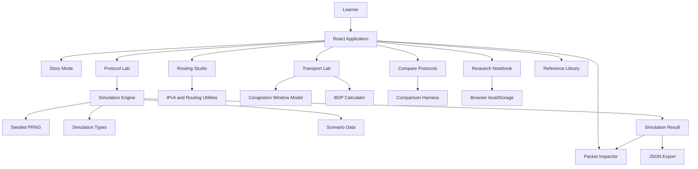

## 4.2 Architectural boundaries

The React application is responsible for:

- Displaying the interface.
- Maintaining UI state.
- Selecting scenarios.
- Rendering experiment results.
- Handling user input.
- Saving notebook entries.
- Triggering JSON exports.

The simulation modules are responsible for:

- Creating deterministic simulation results.
- Representing events.
- Representing packets.
- Computing network metrics.
- Performing routing calculations.
- Producing congestion-window trajectories.

The mock-data modules are responsible for:

- Defining nodes.
- Defining network links.
- Defining scenarios.
- Defining educational lesson content.

The tests validate selected pure-function behavior.

---

# 5. SYSTEM ARCHITECTURE DIAGRAM

## 5.1 Runtime data flow

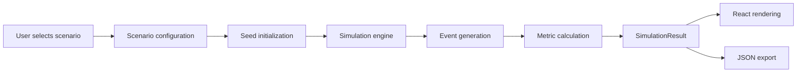

## 5.2 Component responsibilities

| Component | Responsibility |
|---|---|
| App.tsx | Main application interface and view selection |
| engine.ts | Main synthetic simulation |
| types.ts | Shared simulation types |
| prng.ts | Seeded pseudo-random number generation |
| scenarios.ts | Mock network topology and scenarios |
| lessons.ts | Educational reference content |
| routing.ts | IPv4 and route-selection utilities |
| transport.ts | Congestion-window model and BDP |
| compare.ts | Protocol-labelled comparison harness |
| styles.css | Application styling |
| tests | Automated unit tests |

## 5.3 Design rationale

The project keeps core simulation functions outside the React component tree.

This makes the networking calculations easier to test independently.

For example, subnet arithmetic does not require a browser or a React render.

Likewise, the congestion-window model can be tested by supplying a configuration and examining the resulting sequence of rounds.

---

# 6. NETWORK TOPOLOGY

## 6.1 Fictional Toronto-to-Tokyo journey

The baseline topology contains six nodes:

1. Client.
2. Home gateway.
3. ISP edge router.
4. Recursive DNS resolver.
5. CDN edge.
6. Origin service.

The mock topology uses documentation IP ranges for illustrative addresses.

| Node | Label | IP address |
|---|---|---|
| client | Maya's laptop | 192.0.2.10 |
| gateway | Home gateway | 192.0.2.1 |
| isp | ISP edge router | 198.51.100.1 |
| resolver | Recursive DNS | 203.0.113.53 |
| cdn | CDN edge | 203.0.113.80 |
| origin | Origin service | 203.0.113.100 |

## 6.2 Network diagram

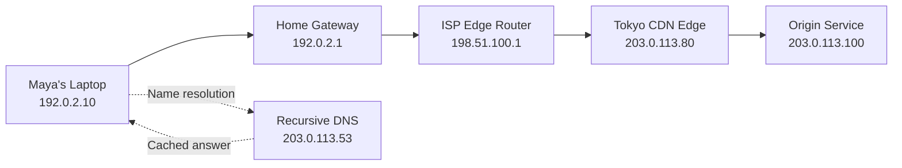

This is a teaching topology rather than a literal representation of the public Internet.

The DNS resolver is represented as a logical service in the scenario. The diagram does not assert that DNS resolution follows the same physical forwarding path as the application traffic.

## 6.3 Link configuration

The mock network defines four links.

| Link | Bandwidth | Propagation | Queue capacity |
|---|---:|---:|---:|
| Client → Gateway | 100 Mbps | 2 ms | 64,000 bytes |
| Gateway → ISP | 50 Mbps | 8 ms | 96,000 bytes |
| ISP → CDN | 20 Mbps | 92 ms | 128,000 bytes |
| CDN → Origin | 100 Mbps | 12 ms | 128,000 bytes |

These values are synthetic teaching parameters.

They are not measurements of real Toronto-to-Tokyo Internet paths.

## 6.4 Network delay concepts

A useful conceptual decomposition is:

```text
Total path delay =
    Processing delay
  + Queueing delay
  + Transmission delay
  + Propagation delay
```

The project emphasizes the distinction between transmission, propagation, and queueing delay.

### Transmission delay

Transmission delay is the time needed to place the packet's bits onto a link.

A simplified formula is:

```text
Transmission delay = Packet size in bits / Link rate in bits per second
```

For example, a 1,400-byte packet contains:

```text
1,400 × 8 = 11,200 bits
```

At 20 Mbps:

```text
11,200 / 20,000,000 = 0.00056 seconds
```

That is approximately:

```text
0.56 milliseconds
```

### Propagation delay

Propagation delay represents the time required for the signal to travel through the physical medium.

It depends on the path and propagation speed.

Increasing bandwidth does not automatically eliminate propagation delay.

### Queueing delay

Queueing delay occurs when packets wait before transmission.

A congested interface can introduce additional delay even when the physical propagation time remains unchanged.

---

# 7. SIMULATION ENGINE

## 7.1 Purpose

The simulation engine produces a synthetic record of a request moving through a simplified network.

Its output is a `SimulationResult`.

That result contains:

- The selected scenario.
- The seed.
- An ordered event collection.
- Packet records.
- Metrics.
- Success state.
- A summary.

## 7.2 Simulation architecture

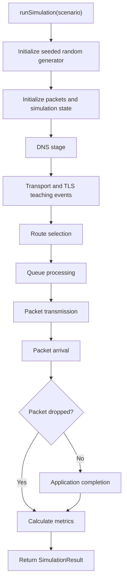

This diagram expresses the educational flow, not a claim that all real networking stacks execute these operations as one simple linear procedure.

## 7.3 Simulation result structure

The result contains the following conceptual structure:

```typescript
interface SimulationResult {
  scenario: Scenario;
  seed: number;
  events: SimEvent[];
  packets: PacketRecord[];
  metrics: Metrics;
  success: boolean;
  summary: string;
}
```

The `events` array is important because it allows the application to present the experiment as a timeline.

## 7.4 Simulation metrics

The application defines:

```typescript
interface Metrics {
  elapsedMs: number;
  deliveredPackets: number;
  droppedPackets: number;
  throughputMbps: number;
  goodputMbps: number;
  lossPercent: number;
  averageDelayMs: number;
  queueDelayMs: number;
}
```

### Elapsed time

The total virtual time represented by the simulation.

### Delivered packets

The number of packet records that reached the modeled delivery state.

### Dropped packets

The number of packet records marked as dropped.

### Throughput

The modeled rate of transmitted data over the simulation interval.

### Goodput

The modeled rate of useful delivered data.

### Loss percentage

The proportion of modeled packets that were dropped.

### Average delay

The average delay represented by the simulation's packet events.

### Queue delay

The queueing delay represented by the simplified scenario.

Metrics should be interpreted in the context of the model's assumptions.

---

# 8. DISCRETE-EVENT MODEL

## 8.1 Event-driven thinking

Instead of treating a request as one indivisible operation, the simulator represents it as a sequence of events.

Each event includes:

- Event identifier.
- Virtual timestamp.
- Sequence number.
- Event type.
- Optional packet identifier.
- Optional node identifier.
- Optional link identifier.
- Human-readable detail.
- Optional byte count.

The event model makes it possible to inspect the sequence of simulated operations.

## 8.2 Event types

The project defines:

| Event | Meaning |
|---|---|
| PacketCreated | A packet record is created |
| QueueEnqueued | A packet enters a modeled queue |
| PacketTransmitted | A packet is transmitted over a modeled link |
| PacketArrived | A packet reaches the next modeled node |
| PacketDropped | A packet is dropped |
| RouteSelected | A route is selected |
| DnsResolved | A DNS result is represented |
| Handshake | A representative connection setup event |
| ApplicationComplete | The application operation completes |

## 8.3 Event sequence diagram

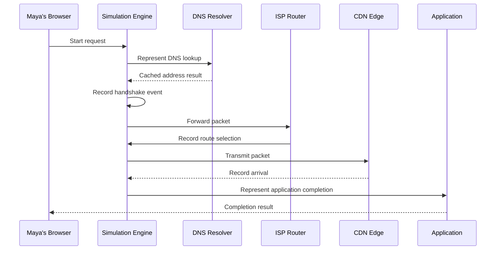

This sequence is a conceptual teaching view.

It does not implement actual socket operations or network exchanges.

## 8.4 Why timestamps matter

Timestamps help learners understand event ordering.

A packet may be:

1. Created.
2. Enqueued.
3. Transmitted.
4. Received.

A dropped packet may never reach the final delivery stage.

By inspecting event order, learners can distinguish a failure during name resolution from a packet-delivery problem.

---

# 9. PACKET LIFECYCLE

## 9.1 Packet states

The project defines the following packet statuses:

```typescript
type PacketStatus =
  | 'created'
  | 'queued'
  | 'in-flight'
  | 'delivered'
  | 'dropped';
```

## 9.2 Lifecycle diagram

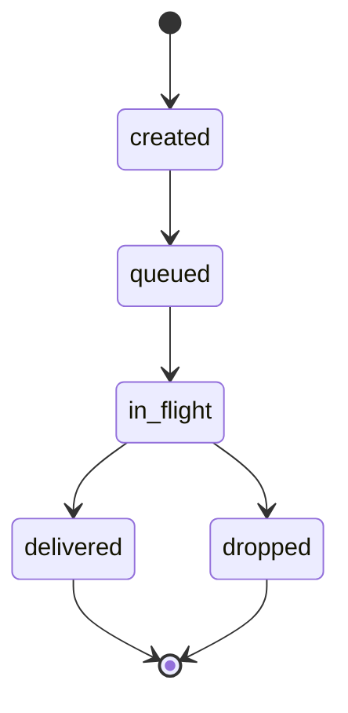

The lifecycle is a simplified educational state model.

It does not represent every possible state in a real operating system or network interface.

## 9.3 Packet records

A packet record includes:

```typescript
interface PacketRecord {
  id: string;
  source: string;
  destination: string;
  bytes: number;
  protocol: string;
  status:
    | 'created'
    | 'queued'
    | 'in-flight'
    | 'delivered'
    | 'dropped';
  path: string[];
  headers: {
    layer: string;
    fields: Record<string, string | number>;
  }[];
}
```

The `path` field represents the modeled route.

The `headers` field contains educational metadata.

It should not be interpreted as a captured packet header from a real network interface.

## 9.4 Packet inspection workflow

A learner can use the inspector to ask:

- What is the source?
- What is the destination?
- What is the modeled packet size?
- What protocol label is associated with the experiment?
- What path did the packet follow?
- What is its final status?
- Which events refer to this packet?

---

# 10. SCENARIO ENGINE AND DETERMINISTIC RANDOMNESS

## 10.1 Why scenarios exist

A networking concept becomes easier to understand when the learner can compare a normal request with a request that experiences a fault.

The project provides four initial scenarios.

| Scenario | ID | Fault |
|---|---|---|
| The first request | `first-request` | none |
| The crowded network | `crowded-uplink` | congestion |
| A missing packet | `packet-loss` | loss |
| The stale address | `dns-stale` | dns |

## 10.2 Scenario descriptions

### The first request

A baseline request that demonstrates the modeled request journey.

### The crowded network

A scenario that introduces additional queue delay.

### A missing packet

A scenario that introduces seeded packet loss.

### The stale address

A scenario representing a stale DNS answer and an unavailable edge.

## 10.3 Deterministic randomness

The project contains a seeded pseudo-random generator in:

```text
src/sim/prng.ts
```

A deterministic seed makes an experiment reproducible.

Conceptually:

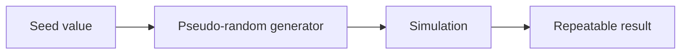

If the seed and simulation inputs are unchanged, the intended outcome is repeatable.

This is useful for:

- Classroom demonstrations.
- Regression tests.
- Comparing scenarios.
- Reproducing a reported result.
- Debugging unexpected behavior.

The pseudo-random generator is not cryptographically secure and must not be used for security-sensitive applications.

---

# 11. ROUTING STUDIO

## 11.1 Purpose

Routing Studio introduces IPv4 addressing, CIDR notation, subnet calculations, and route selection.

The implementation is contained in:

```text
src/sim/routing.ts
```

## 11.2 IPv4 representation

An IPv4 address contains four octets.

Example:

```text
192.0.2.10
```

Each octet represents eight bits.

```text
192       0       2       10
11000000  00000000 00000010 00001010
```

The utility functions convert between dotted-decimal notation and a 32-bit integer representation.

## 11.3 Supported utilities

| Function | Purpose |
|---|---|
| `ipv4ToInt()` | Convert dotted IPv4 to an integer |
| `intToIpv4()` | Convert integer to dotted IPv4 |
| `prefixMask()` | Generate a prefix mask |
| `subnetDetails()` | Calculate subnet information |
| `isInPrefix()` | Check whether an address matches a prefix |
| `longestPrefixMatch()` | Select the most specific matching route |

## 11.4 CIDR notation

CIDR represents an address and prefix length.

Example:

```text
10.1.4.0/24
```

The `/24` indicates that the first 24 bits identify the network prefix.

## 11.5 Subnet calculation flow

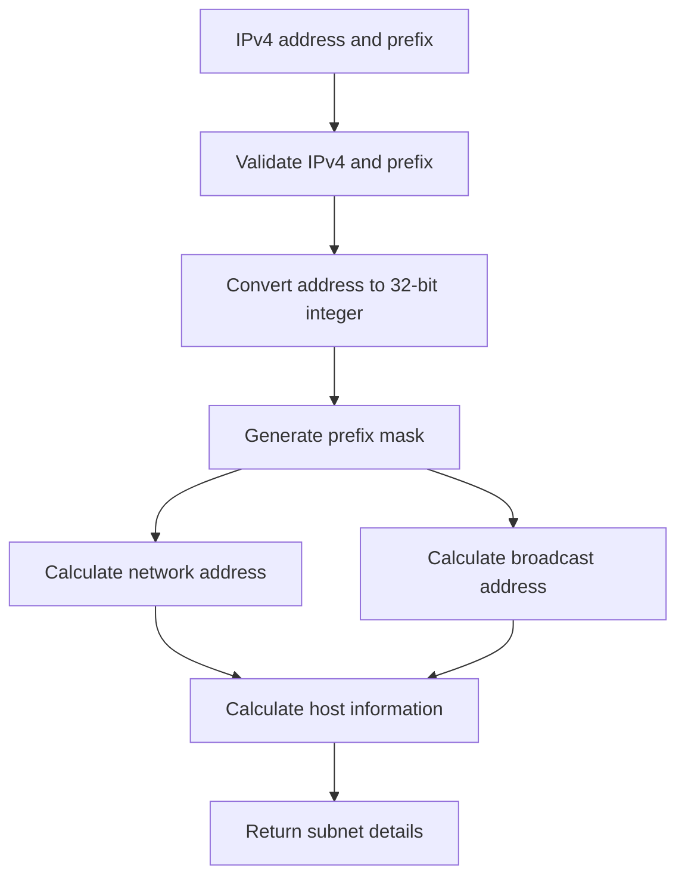

## 11.6 Longest-prefix-match routing

Routers may have multiple routes that match a destination.

The longest-prefix-match rule selects the matching route with the greatest prefix length.

For example, consider:

```text
10.0.0.0/8
10.1.0.0/16
10.1.4.0/24
0.0.0.0/0
```

For destination:

```text
10.1.4.25
```

The `/24` route is the most specific match.

## 11.7 Routing decision diagram

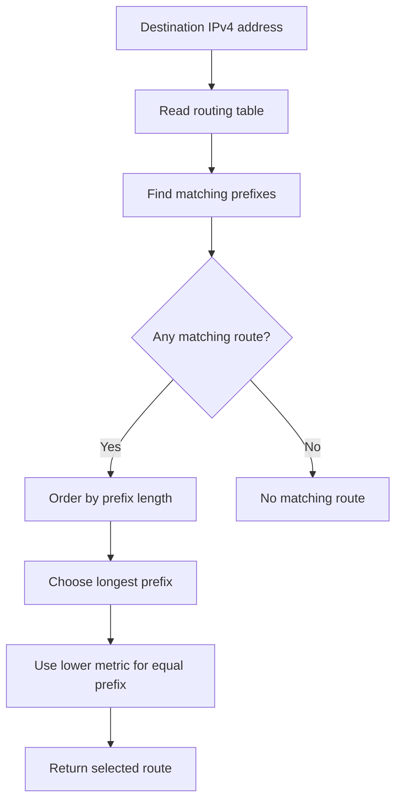

## 11.8 Mock forwarding table

The project includes six demonstration routes.

| Destination | Prefix | Next hop | Interface | Source |
|---|---:|---|---|---|
| 0.0.0.0 | 0 | 198.51.100.254 | wan0 | static |
| 10.0.0.0 | 8 | 10.255.0.1 | core0 | BGP-labelled |
| 10.1.0.0 | 16 | 10.1.255.1 | edge1 | static |
| 10.1.4.0 | 24 | direct | vlan40 | connected |
| 172.16.0.0 | 12 | 172.16.0.1 | vpn0 | static |
| 192.0.2.0 | 24 | direct | lan0 | connected |

The route table is synthetic.

It does not establish BGP sessions or implement route advertisement, path-vector selection, or policy propagation.

## 11.9 Important edge cases

The subnet utility supports prefix lengths from `/0` to `/32`.

The implementation also contains special host-count handling for `/31` and `/32`.

Learners should distinguish between mathematical address counts and deployment-specific subnet conventions.

---

# 12. TRANSPORT LAB

## 12.1 Purpose

Transport Lab introduces congestion-window behavior through a simplified Reno-style model.

The implementation is contained in:

```text
src/sim/transport.ts
```

The lab is designed to make the relationship between congestion windows, acknowledgements, and loss response easier to visualize.

## 12.2 Congestion window

The congestion window, commonly written as `cwnd`, represents a sender-side limit on outstanding data in flight.

The lab represents the window in units of MSS-like segments.

It is a teaching abstraction rather than a byte-accurate TCP sender.

## 12.3 Slow start

In the simplified model, slow start increases the congestion window approximately exponentially.

Conceptually:

```text
cwnd doubles per round
```

The exact growth of a real TCP implementation depends on acknowledgement behavior and other protocol details.

## 12.4 Congestion avoidance

Once the model reaches its slow-start threshold, it represents congestion avoidance with approximately linear growth.

Conceptually:

```text
cwnd increases by approximately one MSS per RTT
```

## 12.5 Loss response

The model includes two loss profiles.

### Three duplicate ACKs

The model:

1. Reduces the slow-start threshold.
2. Enters a fast-recovery teaching state.
3. Uses a simplified recovery transition.

### Retransmission timeout

The model:

1. Reduces the threshold.
2. Resets the congestion window to one MSS.
3. Returns to a slow-start teaching phase.

## 12.6 Congestion-window state diagram

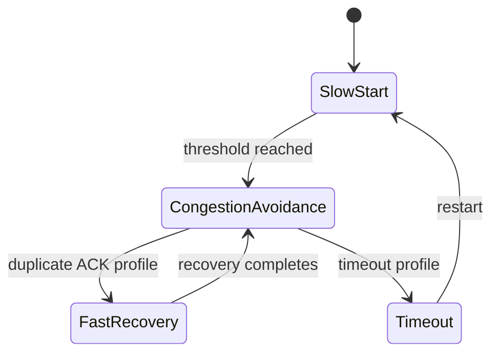

## 12.7 Congestion-window experiment

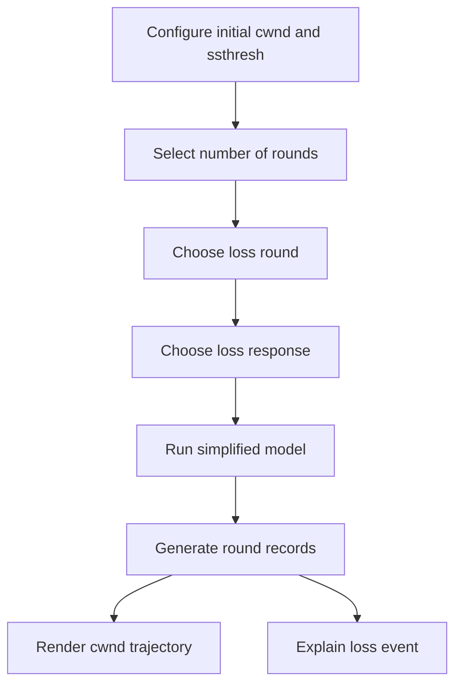

## 12.8 Bandwidth-delay product

The lab also calculates the bandwidth-delay product.

The formula is:

```text
BDP = Bandwidth × Round-trip time
```

When bandwidth is expressed in bits per second and RTT in seconds:

```text
BDP bits = bandwidth (bits/s) × RTT (s)
```

To convert to bytes:

```text
BDP bytes = BDP bits / 8
```

The implementation uses Mbps and milliseconds as input units.

Its function is:

```typescript
bandwidthDelayProductBytes(
  bandwidthMbps: number,
  rttMs: number
): number
```

Example:

```text
Bandwidth = 100 Mbps
RTT = 80 ms

BDP = 100,000,000 × 0.080 / 8

BDP = 1,000,000 bytes
```

This is approximately 1 MB using decimal units.

## 12.9 Model limitations

The congestion-window model is not a complete TCP implementation.

It omits:

- Byte sequence numbers.
- Delayed ACK policy.
- Receive-window limits.
- Selective acknowledgements.
- Pacing.
- Full retransmission timer behavior.
- Modern congestion-control algorithms.
- Actual packet transmission.
- Socket interactions.

The Reno-style label describes the educational model, not standards compliance.

---

# 13. PROTOCOL COMPARISON LAB

## 13.1 Purpose

The comparison view introduces two protocol stacks:

```text
TCP + TLS 1.3 + HTTP/2
QUIC + TLS 1.3 + HTTP/3
```

It gives learners a framework for thinking about transport and application protocol differences.

## 13.2 Comparison data

The comparison result contains:

```typescript
interface ProtocolComparison {
  label: string;
  protocol: Scenario['protocol'];
  elapsedMs: number;
  goodputMbps: number;
  lossPercent: number;
  delivered: number;
  dropped: number;
  caveat: string;
}
```

## 13.3 Comparison workflow

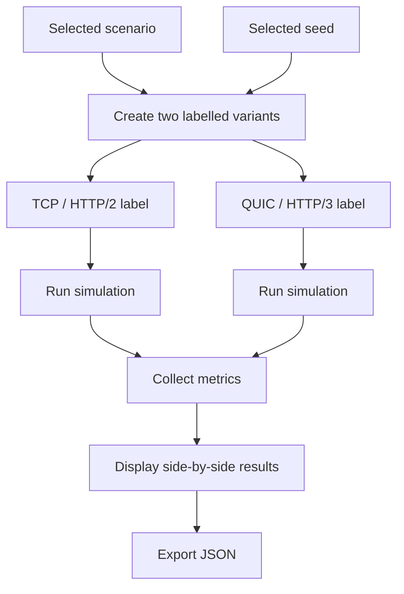

## 13.4 Interpretation warning

The current implementation uses the same simplified event engine for both labels.

It does not implement:

- TCP congestion control versus QUIC congestion control.
- HTTP/2 stream scheduling.
- HTTP/3 stream behavior.
- QUIC packet-number spaces.
- QUIC ACK ranges.
- QUIC loss recovery.
- Connection migration.
- Actual TLS cryptography.
- Protocol-specific handshake timing.

Therefore, the comparison cannot demonstrate real performance differences between TCP and QUIC.

It is currently an experimental interface and a foundation for future protocol-specific modeling.

## 13.5 Future implementation direction

A future version should separate protocol-specific behavior behind a shared simulation interface.

Possible architecture:

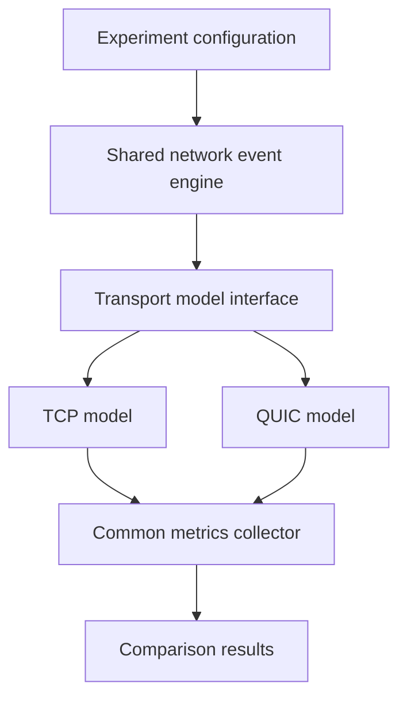

This would allow the comparison harness to measure meaningful differences once both models implement distinct behavior.

---

# 14. PACKET INSPECTOR

## 14.1 Purpose

Packet Inspector exposes the simulated event and packet records.

It helps connect the abstract simulation with the concepts learners encounter in packet analyzers.

## 14.2 What is visible?

The underlying data model supports:

- Packet ID.
- Source.
- Destination.
- Packet size.
- Protocol label.
- Status.
- Path.
- Layer-labelled metadata.
- Event timestamps.
- Event type.
- Event details.

## 14.3 Packet inspection workflow

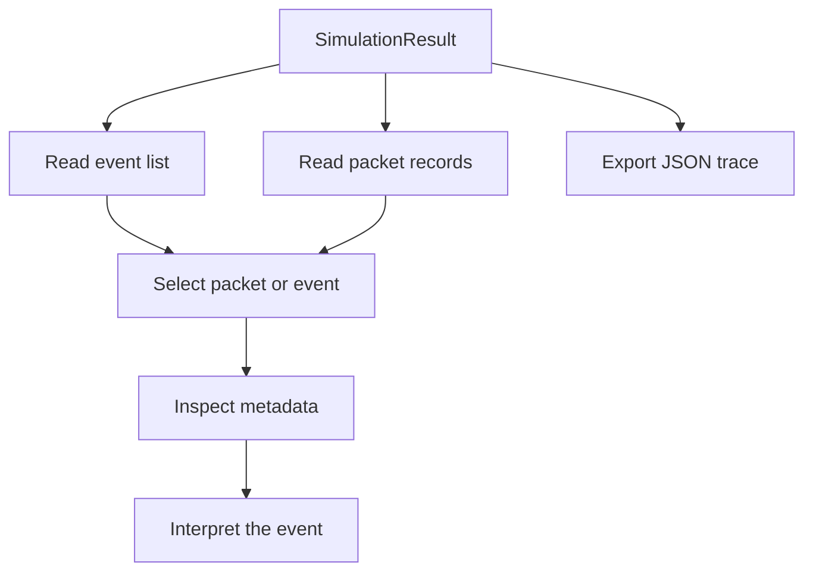

## 14.4 JSON export

The application supports exporting simulation results as JSON.

A simplified representation:

```json
{
  "scenario": {
    "id": "first-request"
  },
  "seed": 4172,
  "success": true,
  "events": [],
  "packets": [],
  "metrics": {
    "elapsedMs": 0,
    "deliveredPackets": 0,
    "droppedPackets": 0,
    "throughputMbps": 0,
    "goodputMbps": 0,
    "lossPercent": 0,
    "averageDelayMs": 0,
    "queueDelayMs": 0
  }
}
```

The values above are placeholders illustrating the structure, not a claimed experiment result.

## 14.5 Future packet-analysis extensions

Potential future features:

- Filtering by event type.
- Filtering by packet ID.
- Timeline zoom.
- Event grouping by node.
- Export to CSV.
- Search by source or destination.
- Packet path visualization.
- Header-field explanations.
- Side-by-side event comparison.

A future PCAP export would require a real packet serialization layer. Renaming the existing JSON trace as a PCAP file would be incorrect.

---

# 15. STORY MODE AND RESEARCH NOTEBOOK

## 15.1 Story Mode

Story Mode provides the narrative context for the networking journey.

It helps learners associate technical events with an understandable user request.

The fictional setting should not be mistaken for a real-world measurement.

## 15.2 Research Notebook

The notebook saves learner observations in browser local storage.

The current storage key is:

```text
ius-notes
```

The application stores up to 30 entries.

## 15.3 Notebook data flow

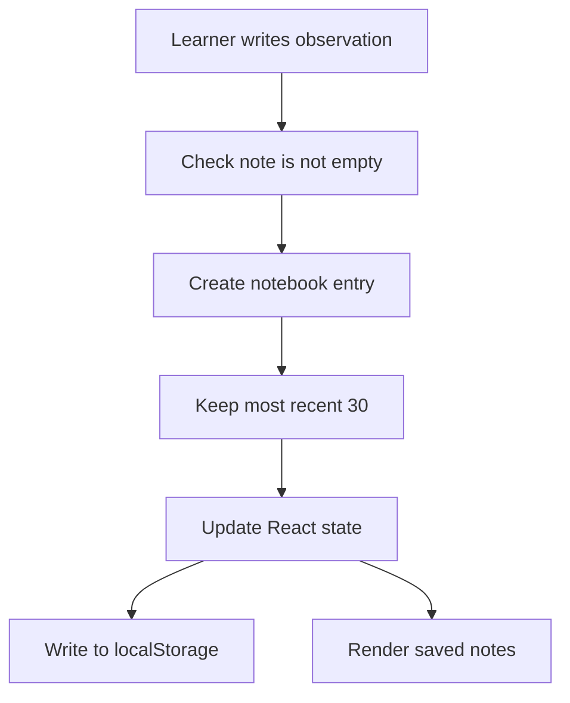

## 15.4 Privacy and persistence

Notebook entries remain in the user's browser storage.

They are not automatically synchronized to a remote server.

Clearing browser storage may remove the saved notes.

The current application does not provide a user-account system or cloud notebook synchronization.

## 15.5 Future notebook features

Possible improvements:

- Export notes to Markdown.
- Export notes to JSON.
- Add experiment tags.
- Add custom titles.
- Compare observations across seeds.
- Add a lab report template.
- Add downloadable experiment summaries.

---

# 16. DATA STRUCTURES AND TYPE DEFINITIONS

The project uses TypeScript interfaces to make simulation data explicit.

The central definitions are located in:

```text
src/sim/types.ts
```

## 16.1 Network node

```typescript
export type NodeKind =
  | 'client'
  | 'gateway'
  | 'router'
  | 'resolver'
  | 'cdn'
  | 'origin';

export interface NetworkNode {
  id: string;
  label: string;
  kind: NodeKind;
  location: string;
  ip: string;
  description: string;
}
```

## 16.2 Network link

```typescript
export interface NetworkLink {
  id: string;
  from: string;
  to: string;
  bandwidthMbps: number;
  propagationMs: number;
  queueCapacityBytes: number;
  lossRate: number;
}
```

## 16.3 Scenario

```typescript
export interface Scenario {
  id: string;
  title: string;
  subtitle: string;
  seed: number;
  packetBytes: number;

  protocol:
    | 'TCP + TLS 1.3 + HTTP/2'
    | 'QUIC + TLS 1.3 + HTTP/3';

  fault:
    | 'none'
    | 'congestion'
    | 'loss'
    | 'dns';

  description: string;
}
```

## 16.4 Simulation event

```typescript
export interface SimEvent {
  id: string;
  timeMs: number;
  sequence: number;
  type: EventType;
  packetId?: string;
  nodeId?: string;
  linkId?: string;
  detail: string;
  bytes?: number;
}
```

## 16.5 Why typed data matters

Explicit interfaces improve:

- Code readability.
- Refactoring safety.
- Test clarity.
- Component integration.
- Data consistency.
- Future extension.

The types also make it easier to introduce additional network models without changing every part of the application.

---

# 17. REPOSITORY STRUCTURE

```text
the-internet-unscripted/
│
├── index.html
├── package.json
├── vite.config.ts
├── tsconfig.json
├── tsconfig.app.json
├── tsconfig.node.json
├── .replit
├── .gitignore
│
├── README.md
├── CHANGELOG.md
│
├── src/
│   ├── main.tsx
│   ├── App.tsx
│   ├── styles.css
│   │
│   ├── components/
│   │
│   ├── data/
│   │   ├── scenarios.ts
│   │   └── lessons.ts
│   │
│   └── sim/
│       ├── types.ts
│       ├── prng.ts
│       ├── engine.ts
│       ├── routing.ts
│       ├── transport.ts
│       └── compare.ts
│
└── tests/
    ├── engine.test.ts
    ├── routing.test.ts
    └── transport.test.ts
```

## 17.1 Source directory

The `src` directory contains the application code.

## 17.2 Data directory

The `data` directory contains synthetic network scenarios and educational reference content.

## 17.3 Simulation directory

The `sim` directory contains the simulation engine and networking utilities.

## 17.4 Tests directory

The `tests` directory contains unit tests for the engine, routing utilities, and transport model.

## 17.5 Package scripts

The project defines these scripts:

```json
{
  "scripts": {
    "dev": "vite --host 0.0.0.0",
    "build": "tsc -b && vite build",
    "preview": "vite preview --host 0.0.0.0",
    "test": "vitest run",
    "test:watch": "vitest"
  }
}
```

---

# 18. INSTALLATION AND REPLIT DEPLOYMENT

## 18.1 Requirements

- Node.js compatible with the selected Vite version.
- npm.
- A modern browser.
- Internet access for initial dependency installation.

## 18.2 Local installation

Clone the repository:

```bash
git clone https://github.com/YOUR_USERNAME/the-internet-unscripted.git
```

Enter the project directory:

```bash
cd the-internet-unscripted
```

Install dependencies:

```bash
npm install
```

Start the development server:

```bash
npm run dev
```

## 18.3 Replit installation

1. Create a new Node.js Repl.
2. Upload the project ZIP.
3. Extract the archive.
4. Open the Shell.
5. Install dependencies.
6. Start the development server.

Commands:

```bash
npm install
npm run dev -- --host 0.0.0.0
```

The `.replit` configuration is included in the project.

## 18.4 Production build

Run:

```bash
npm run build
```

Vite produces the production output in:

```text
dist/
```

## 18.5 Preview production build

```bash
npm run preview
```

## 18.6 Run tests

```bash
npm test
```

For watch mode:

```bash
npm run test:watch
```

## 18.7 Deployment architecture

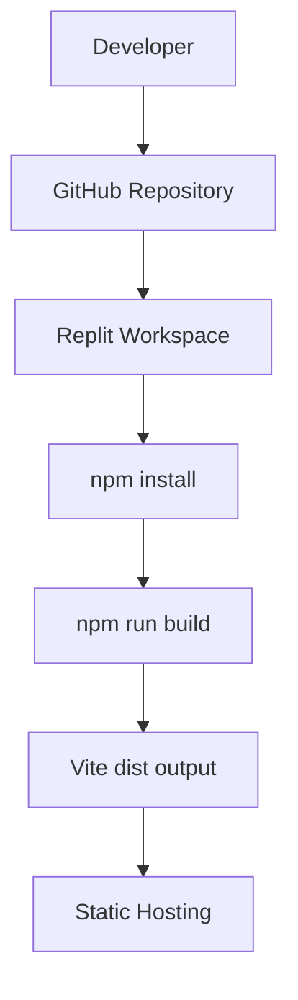

This is a suggested deployment workflow. It does not mean that a production hosting provider is already configured.

---

# 19. TESTING AND VERIFICATION

## 19.1 Testing philosophy

The networking utilities should be testable independently from the visual interface.

Pure functions are particularly suitable for unit testing.

Examples include:

- IPv4 conversion.
- Prefix-mask generation.
- Subnet calculation.
- Longest-prefix matching.
- Bandwidth-delay product.
- Congestion-window behavior.

## 19.2 Test organization

```text
tests/
├── engine.test.ts
├── routing.test.ts
└── transport.test.ts
```

## 19.3 Routing test areas

Routing tests should cover:

- Valid IPv4 conversion.
- Invalid IPv4 input.
- Prefix boundaries.
- Network address calculations.
- Broadcast address calculations.
- Prefix membership.
- Longest-prefix selection.
- Default route behavior.
- Equal-prefix metric tie-breaking.

## 19.4 Transport test areas

Transport tests should cover:

- Slow-start behavior.
- Congestion avoidance.
- Duplicate-ACK response.
- Timeout response.
- No-loss behavior.
- Round-count boundaries.
- Bandwidth-delay product calculations.

## 19.5 Simulation test areas

Engine tests should cover:

- Scenario initialization.
- Deterministic seed behavior.
- Event generation.
- Packet status transitions.
- Successful completion.
- Packet loss.
- DNS failure.
- Metric consistency.

## 19.6 Suggested test command sequence

```bash
npm install
npm run build
npm test
```

## 19.7 Verification status

The v1.1 project has undergone source-level checks and simulation smoke checks.

A full dependency installation, production Vite build, and complete Vitest execution were not confirmed in the environment used to prepare the project.

Run the commands above in Replit before treating the application as fully release-verified.

---

# 20. MODEL LIMITATIONS, ROADMAP, AND CONTRIBUTION GUIDE

## 20.1 What this project currently is

The Internet, Unscripted is:

- A React and TypeScript educational application.
- A deterministic synthetic simulation.
- A mock network topology.
- An IPv4 subnet calculator.
- A longest-prefix-match demonstration.
- A simplified congestion-window teaching model.
- A protocol-labelled comparison interface.
- A packet-event inspection interface.
- A local research notebook.

## 20.2 What this project currently is not

It is not:

- A production TCP/IP implementation.
- A live network scanner.
- A packet capture tool.
- A Wireshark replacement.
- A real BGP router.
- A real DNS resolver.
- A real QUIC implementation.
- A cryptographic TLS implementation.
- A public Internet measurement platform.
- A standards-compliant congestion-control simulator.

The application does not send actual public Internet traffic.

## 20.3 Technical limitations

### Simplified event model

The event sequence represents educational stages rather than every operation in a real operating system network stack.

### Synthetic topology

The Toronto-to-Tokyo topology uses fictional nodes and configured values.

### Queue approximation

The congestion scenario uses a simplified queue-delay teaching approximation.

### Seeded packet loss

The loss scenario uses deterministic pseudo-randomness rather than a physical network channel.

### Simplified transport

The congestion-window model does not implement a full TCP sender or receiver.

### Protocol comparison

The TCP and QUIC labels currently share the same simplified event engine.

### Routing

The routing utilities calculate IPv4 subnet information and longest-prefix matches. They do not implement routing protocols.

## 20.4 Development roadmap

The following roadmap describes potential future development, not features already completed.

### Phase 1 — Multi-packet simulation

Add:

- Multiple concurrent packet flows.
- Packet identifiers across flows.
- Per-flow event timelines.
- Configurable packet sizes.
- Per-link queues.
- Queue capacity enforcement.
- More detailed serialization calculations.

### Phase 2 — TCP state machine

Add:

- Sequence numbers.
- Acknowledgement numbers.
- Sliding windows.
- Receive-window constraints.
- Retransmission timers.
- Duplicate ACK tracking.
- Selective acknowledgements.
- Explicit retransmission events.

### Phase 3 — Congestion-control experiments

Add separate implementations for:

- Reno-style behavior.
- Cubic-inspired behavior.
- BBR-inspired conceptual behavior.

Each model should have a clearly defined abstraction and test suite.

### Phase 4 — QUIC educational model

Add:

- Packet-number spaces.
- Stream identifiers.
- ACK-range representations.
- Loss detection.
- Connection migration concepts.
- Independent congestion-control model.

This should be a new model, not merely a protocol label.

### Phase 5 — Routing research lab

Add:

- Multiple routing tables.
- Route policy experiments.
- Autonomous-system mock topology.
- BGP path attributes as synthetic data.
- Route advertisement and withdrawal events.
- Route convergence visualization.

### Phase 6 — DNS laboratory

Add:

- Recursive lookup stages.
- TTL countdown.
- Cache hit and miss.
- Negative caching.
- Stale-answer experiments.
- Authoritative-server mock data.

### Phase 7 — Advanced visualization

Add:

- Interactive topology graph.
- Animated packet movement.
- Per-link queue visualization.
- Timeline scrubbing.
- Side-by-side experiment playback.
- Event filtering.
- More detailed packet metadata.

### Phase 8 — Classroom and research features

Add:

- Instructor-created scenarios.
- Learner experiment reports.
- Exportable Markdown reports.
- Custom seed sharing.
- Experiment comparison history.
- Guided assignments.
- Rubric-based learning objectives.

## 20.5 Proposed future architecture

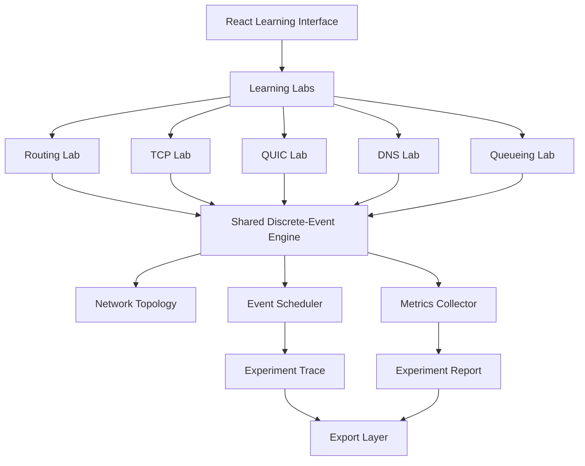

The purpose of this architecture is to keep protocol-specific behavior separate while sharing common network concepts such as links, nodes, events, and metrics.

## 20.6 Contribution guide

Contributions are welcome.

Good initial contributions include:

- Improving educational explanations.
- Adding subnet edge-case tests.
- Improving accessibility.
- Adding new mock scenarios.
- Improving event descriptions.
- Adding packet inspection filters.
- Improving the README.
- Adding diagrams.
- Improving responsive layouts.

### Contribution workflow

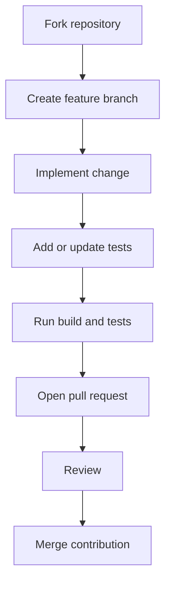

### Suggested branch naming

```text
feature/multi-packet-flows
feature/dns-cache-lab
feature/interactive-topology
fix/ipv4-validation
docs/transport-lab
test/routing-edge-cases
```

### Pull request expectations

A contribution should include:

1. A clear description of the change.
2. The educational concept being improved.
3. Tests for new simulation logic.
4. Documentation for new controls.
5. An explanation of any new model assumptions.
6. Explicit limitations where behavior is simplified.

## 20.7 Educational integrity

The most important contribution rule is to distinguish between:

- A real networking protocol.
- A simplified model of that protocol.
- A visual representation of a protocol.
- Synthetic data used for an experiment.

A diagram or chart should never imply that an unimplemented protocol feature is already working.

This principle is especially important for TCP, QUIC, TLS, DNS, BGP, packet capture, and performance comparisons.

## 20.8 License

This project can use the MIT License if the repository owner chooses to publish it under that license.

Before publishing, add a `LICENSE` file containing the complete license text and confirm that all third-party assets and dependencies are compatible with the chosen distribution terms.

## 20.9 Acknowledgements

The project builds on widely used concepts in computer networking education:

- Internet Protocol addressing.
- CIDR subnetting.
- Longest-prefix-match routing.
- DNS resolution.
- Packet switching.
- Queueing theory.
- TCP congestion-control concepts.
- Bandwidth-delay product.
- HTTP/2 and HTTP/3 architectural concepts.

The application is an independent educational implementation and should not be interpreted as an official implementation or endorsement by protocol standards organizations.

---

# FINAL PROJECT SUMMARY

**The Internet, Unscripted** is an interactive computer networking laboratory that makes abstract networking concepts easier to explore.

Its current implementation combines:

- A Toronto-to-Tokyo mock network journey.
- Deterministic simulation scenarios.
- Packet and event inspection.
- IPv4 subnet calculations.
- Longest-prefix-match routing.
- A simplified congestion-window model.
- A bandwidth-delay product calculator.
- Protocol-labelled comparison experiments.
- A local research notebook.
- Educational reference content.

The long-term vision is to grow the project into a modular networking laboratory where learners can investigate packet delivery, routing decisions, congestion, DNS, transport protocols, and network performance through repeatable experiments.

**The central idea: Don't just learn how the Internet works. Follow the request, inspect the events, change the conditions, and investigate what happens.**

---

*Documentation version: 1.1.0*  
*Project: The Internet, Unscripted — Maya & Chloe’s World Tour*  
*Technology: React, TypeScript, Vite, Vitest*  
*Simulation type: Deterministic educational network model*
